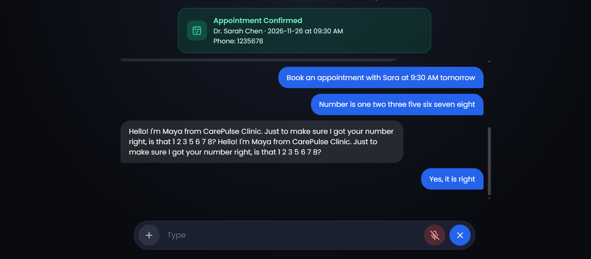
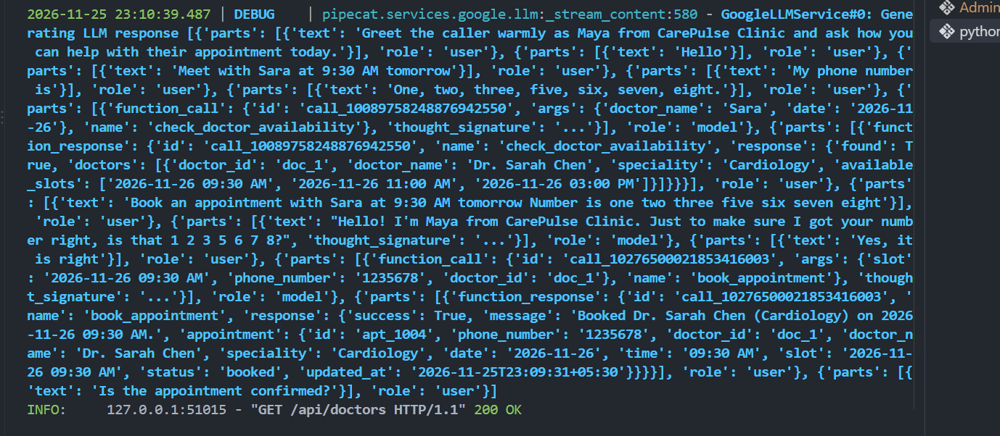

# CarePulse — Voice AI Doctor Appointment Assistant

Real-time voice AI receptionist built with **Pipecat** (SmallWebRTC + Silero VAD + ElevenLabs STT/TTS + Google Gemini `gemini-3.5-flash`) and a **React + Vite** dashboard.

## Quick Links
- **Demo Video:** [CLICK HERE](https://youtu.be/nDAlIelKteU)
- **Live Deployment:** [CLICK HERE](https://voice-appointment-assistant.vercel.app/)

> 

## Features
- **Real-Time Voice Receptionist:** Natural, low-latency voice conversations over WebRTC with Silero VAD turn detection and interruption handling.
- **Phone-Only Caller Verification:** Identifies callers solely by their spoken phone number and reads it back digit-by-digit for explicit `"yes"` confirmation before booking or cancelling.
- **End-to-End Appointment Tools:** Checks doctor availability by name, speciality, or date, books open slots, and cancels existing appointments in a single conversation.
- **Live Synced Dashboard:** Displays doctors, available slot chips, summary metrics, and an appointments table that polls and highlights newly booked or cancelled rows in real time.
- **Voice + Text Chat Screen:** ChatGPT-style voice interface with an audio-reactive orb, full live transcript bubbles, mute/end controls, and typed message support.

## Tech Stack
- **Voice Framework:** Pipecat (`pipecat-ai==1.17.0`) with `SmallWebRTCTransport` & `RTVIProcessor`
- **VAD:** Silero VAD (`SileroVADAnalyzer`)
- **STT & TTS:** ElevenLabs (`ElevenLabsSTTService`, `ElevenLabsTTSService`)
- **LLM:** Google Gemini (`gemini-3.5-flash` via `GoogleLLMService` with function calling, bounded stream retry, and spoken timeout recovery)
- **Backend:** FastAPI + Uvicorn + in-memory JSON store (`backend/data.json`)
- **Frontend:** React + Vite + `@pipecat-ai/client-js` + `@pipecat-ai/small-webrtc-transport`

## Setup & Run

### API Keys Required (`backend/.env`)
- `ELEVENLABS_API_KEY` — Used by Pipecat's `ElevenLabsSTTService` (speech-to-text) and `ElevenLabsTTSService` (text-to-speech) for real-time voice transcription and synthesis.
- `GOOGLE_API_KEY` — Used by `GoogleLLMService` (`gemini-3.5-flash`) to power conversational reasoning and function calling (`check_doctor_availability`, `book_appointment`, `cancel_appointment`).
- `ELEVENLABS_VOICE_ID` *(optional)* — Overrides the default free-tier compatible voice (`EXAVITQu4vr4xnSDxMaL` — Sarah).

### 1. Backend
```bash
cd backend
python -m venv .venv
# Windows: .venv\Scripts\activate   |   macOS/Linux: source .venv/bin/activate
pip install -r requirements.txt
cp .env.example .env   # Add ELEVENLABS_API_KEY and GOOGLE_API_KEY
python server.py
```
Backend runs on `http://localhost:7860`.

### 2. Frontend
```bash
cd frontend
npm install && npm run dev
```
Frontend runs on `http://localhost:5173` (proxies `/api/*` to `http://localhost:7860`).

## Screenshots
### Voice Conversation and Appointment Confirmation


### Caller Verification and Appointment Booking Logs

